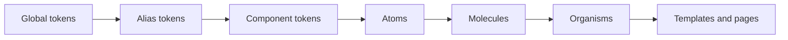

# VSA Design System

The VSA Design System is a set of tokens and components for the user interfaces of VSA apps. A screen uses only parts from this system. A change to a token or a component changes each screen that uses it.

## Levels



| Level | Example | Where |
|---|---|---|
| Global token | `--vsa-orange-370: #ff6a1a` | `tokens/global.css` |
| Alias token | `--vsa-color-accent: var(--vsa-orange-370)` | `tokens/alias.css` |
| Component token | `--vsa-toggle-track-on: var(--vsa-color-accent)` | `tokens/component.css` |
| Atom | `<vsa-button>`, `<vsa-toggle>`, `<vsa-field>` | `components/` |
| Molecule | `<vsa-search-bar>` | `components/` |
| Organism | `<vsa-settings-panel>` | `components/` |
| Page | Runner Home | Phase 3 |

## Folder map

| Path | Content |
|---|---|
| `tokens/` | The tokens. CSS is the source. See `tokens/README.md` |
| `components/` | The atoms: one web component in each file, with shadow DOM and no build |
| `gallery/index.html` | The gallery: Overview, Foundations and Tokens pages, with a theme switch |
| `themes/default.json` | The settings of the default theme, as saved in Runner Studio |
| `reference/default.css` | The CSS that Runner Studio exported for the default theme. A record of the choice: the tokens are the source |
| `reference/runner-studio.html` | The Runner Studio source: the reference for the token values and the component shapes |
| `docs/decisions/` | Design decisions: `0001` default theme, `0002` component standards, `0003` component tokens, `0004` variants and levels |

## Use the tokens and the atoms

1. Load `tokens/fonts.css`, `tokens/global.css`, `tokens/alias.css` and `tokens/component.css`, in this order.
2. Read only alias tokens and component tokens in your CSS.
3. Load each atom that you use as a module script.
4. To make an area dark, set `data-theme="dark"` on its element. Without the attribute, the area follows the system theme.

```html
<link rel="stylesheet" href="Design/tokens/fonts.css">
<link rel="stylesheet" href="Design/tokens/global.css">
<link rel="stylesheet" href="Design/tokens/alias.css">
<link rel="stylesheet" href="Design/tokens/component.css">
<script type="module" src="Design/components/vsa-toggle.js"></script>
<style>
  .panel { background: var(--vsa-gradient-surface); box-shadow: var(--vsa-shadow-raise); border-radius: var(--vsa-radius-card); }
</style>
<vsa-toggle name="pin" checked aria-label="Pin"></vsa-toggle>
```

## Open the gallery

The gallery reads the token files with relative paths. A browser that opens the file directly can block these files. Serve the `Design/` folder with any static web server, then open `/gallery/index.html`.

| Menu group | Pages | Content |
|---|---|---|
| Overview | Overview | All atoms on one page, with an event log |
| Foundations | Color, Typography, Spacing and radius, Elevation, Motion | The alias tokens in use, each with its path to the global value |
| Components | Button, Search bar, Settings panel | One page for each component: level, variants and states, parts, API, events, tokens and usage |
| Tokens | Global, Alias, Component | One page for each level. The gallery reads the rows from the CSS files. "Used by" shows the tokens of the next level that read each token |

## Phases

| Phase | Content | State |
|---|---|---|
| 0 | Lock the default theme | Done |
| 1 | Tokens: global, alias, light and dark | Done |
| 2 | Atoms as web components with shadow DOM, with component tokens | In progress: button, toggle, field done. The button has the variants `primary` and `small` |
| 3 | Molecules, organisms, and Runner Home built from the parts | Started: one molecule and one organism, as examples |
| 4 | Declarative UI: a screen from JSON | Planned. The JSON shape is not decided |

## Open questions

- On a phone, the pressed state of the button shows late. Mobile browsers wait a short time before `:active`, to find a scroll, and the transition adds 150 ms. Find the correct feedback for touch.

## Non-goals

- No build step. Reason: CSS custom properties work in each browser, in WebView2 and in Blazor without tools.
- No JSON token file. Reason: CSS is the only source. A converter can make JSON when a platform needs it.
- One style for each atom, the style of the default theme: channel toggle, carved field, carved segmented control. Reason: one look for all screens. A second style comes with a second theme.
- No second theme yet. Reason: global tokens make a second theme possible, but no app needs one.
