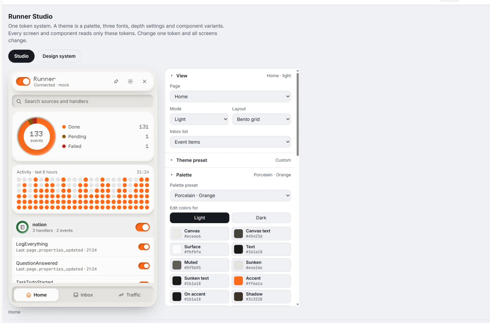

# 0001: The default theme

**Decision:** The default theme of the VSA Design System is the theme "choice" from Runner Studio.

## Source

| Item | Value |
|---|---|
| Tool | Runner Studio, `https://claude.ai/artifact/TcLRUSCig731AfYVSG14uh` |
| Saved theme | "choice", collection `themes`, document `tmw5ga7z1`, 2026-11-06 |
| Settings | `themes/default.json` |
| Exported CSS | `reference/default.css` |

## The theme

| Layer | Value |
|---|---|
| Palette | Porcelain · Orange: warm light grays, cool dark grays, accent `#ff6a1a` |
| Type | Doto for display, Inter for body, JetBrains Mono for mono |
| Depth | Depth 45, bevel 70, carve 60, glow 25, glass 0, radius 22 |
| Layout | Bento |
| Components | Header bar, nav well, carved field, carved-arc ring, channel toggle, dot chart, dot meter, ring timeline |

## Rules that follow

- The first alias tokens came from `reference/default.css`. Now the tokens are the source, and the reference is only a record of the choice.
- The depth numbers are not tokens. The exported shadows are the tokens. Runner Studio used the numbers only to find the style.
